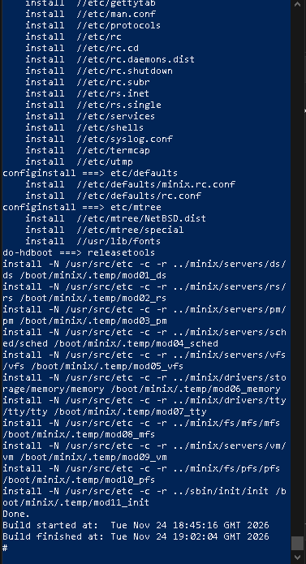
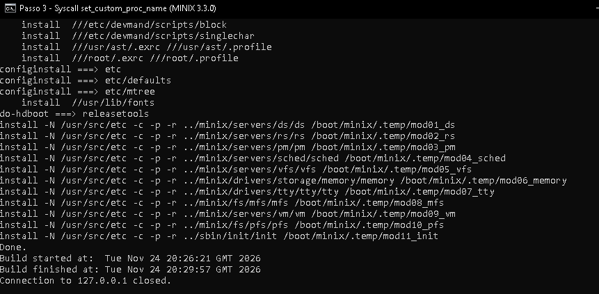
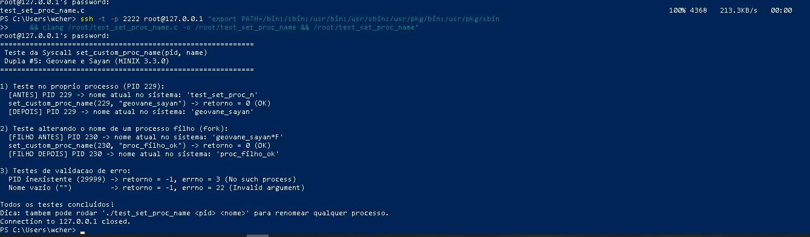

# Trabalho de Sistemas Operacionais — MINIX 3.3.0

## Syscall: `set_custom_proc_name(pid, name)`

**Dupla #5:** Geovane e Sayan  
**Ambiente:** MINIX 3.3.0 (i386) via Oracle VirtualBox + OpenSSH  

---

## 1. Objetivo

Compreender na prática a arquitetura de um sistema operacional baseado em **microkernel** (MINIX 3), adicionando uma chamada de sistema nativa (`set_custom_proc_name`) que altera dinamicamente o nome de um processo específico tanto no **Process Manager (PM)** quanto no **Kernel**, e consumindo-a por meio de um programa em C no espaço de usuário (*User Space*).

### Assinatura da System Call

```c
#include <unistd.h>

int set_custom_proc_name(pid_t pid, const char *name);
```

- **`pid`**: PID do processo alvo (`0` altera o nome do próprio processo chamador).
- **`name`**: string não vazia com o novo nome (truncada de forma segura para `PROC_NAME_LEN - 1` caracteres).
- **Retorno**: `0` em caso de sucesso, ou `-1` em caso de erro com `errno` ajustado (`EINVAL`, `ESRCH`, `EPERM` ou `EFAULT`).

---

## 2. Estrutura do Repositório

```text
trabalho_minix/
├── README.md                                  # Instruções de execução e Relatório Técnico
├── docs/
│   ├── kernel_original_build.png              # Print da compilação do kernel original na VM
│   ├── kernel_custom_build.png                # Print da compilação com a nova syscall
│   └── teste_syscall.png                      # Print da execução do programa de teste em C
├── scripts/
│   └── apply_syscall.sh                       # Script para aplicar todos os arquivos em /usr/src
├── src_changes/                               # Espelho dos 16 arquivos criados/modificados no MINIX 3.3.0
│   ├── include/unistd.h
│   └── minix/
│       ├── include/minix/{callnr.h,com.h,ipc.h,syslib.h}
│       ├── lib/libc/sys/{Makefile.inc,set_custom_proc_name.c}
│       ├── lib/libsys/{Makefile,sys_setname.c}
│       ├── servers/pm/{proto.h,table.c,misc.c}
│       └── kernel/{system.h,system.c,system/Makefile.inc,system/do_setname.c}
└── user_test/
    └── test_set_proc_name.c                   # Programa em C (User Space) para testar a syscall
```

---

## 3. Validação do Ambiente (Kernel Original)

Antes de qualquer alteração no código-fonte, instalamos o MINIX 3.3.0 em uma VM no VirtualBox (2 GB RAM, 4 vCPUs, disco virtual de 2 GB, rede NAT com redirecionamento de porta SSH `2222 -> 22`), baixamos o código-fonte oficial em `/usr/src` e validamos o ambiente com a compilação completa do kernel original (`make build`):



---

## 4. Como Compilar e Rodar o Código

### Pré-requisitos
- VM com **MINIX 3.3.0** instalada e código-fonte em `/usr/src`.
- Acesso ao terminal da VM (localmente ou via SSH, por exemplo `ssh -p 2222 root@127.0.0.1`).

### Passo 1 — Copiar o repositório para a VM
A partir da máquina hospedeira (ou clonando diretamente):
```bash
tar -czf trabalho_minix.tar.gz trabalho_minix
scp -O -P 2222 trabalho_minix.tar.gz root@127.0.0.1:/tmp/
```

### Passo 2 — Aplicar os arquivos da syscall em `/usr/src`
Dentro da VM MINIX:
```sh
export PATH=/bin:/sbin:/usr/bin:/usr/sbin:/usr/pkg/bin:/usr/pkg/sbin
cd /tmp
tar -xzf trabalho_minix.tar.gz
sh /tmp/trabalho_minix/scripts/apply_syscall.sh
```

O script `apply_syscall.sh` copia automaticamente todos os 16 arquivos modificados/criados para `/usr/src` e copia o programa de teste para `/root/test_set_proc_name.c`.

### Passo 3 — Recompilar o MINIX 3 e reiniciar
```sh
cd /usr/src
make build MKUPDATE=yes
```

Após finalizar (`Build finished at: ...` e instalação da nova imagem em `/boot/minix_latest`), reinicie a VM para carregar o novo Kernel e o novo Process Manager:
```sh
/sbin/reboot
```



### Passo 4 — Compilar e executar o programa de teste (User Space)
Após o reinício da VM, faça login como `root` e execute:
```sh
export PATH=/bin:/sbin:/usr/bin:/usr/sbin:/usr/pkg/bin:/usr/pkg/sbin
clang /root/test_set_proc_name.c -o /root/test_set_proc_name
/root/test_set_proc_name
```

#### Modo manual (opcional)
O programa também aceita argumentos na linha de comando para renomear qualquer processo ativo:
```sh
/root/test_set_proc_name <pid> <novo_nome>
```

### Resultado da Execução



O teste valida quatro cenários:
1. **Renomeação do próprio processo:** muda `'test_set_proc_n'` para `'geovane_sayan'` (verificado em `/proc/<pid>/psinfo`).
2. **Renomeação de processo filho (`fork`):** o filho herda o nome já alterado do pai (`'geovane_sayan*F'`) e em seguida é renomeado para `'proc_filho_ok'`.
3. **Validação de PID inexistente (`29999`):** retorna `-1` com `errno = 3 (ESRCH — No such process)`.
4. **Validação de nome vazio (`""`):** retorna `-1` com `errno = 22 (EINVAL — Invalid argument)`.

---

## 5. Relatório Técnico

### 5.1. Fluxo Completo da Syscall nas Camadas do MINIX 3

Diferente de kernels monolíticos (como o Linux), no microkernel **MINIX 3** a tabela de processos e as políticas de gerenciamento de processos ficam em servidores no espaço de usuário — especialmente no **Process Manager (PM)** — enquanto o **Kernel** mantém apenas a estrutura mínima de escalonamento e IPC (`struct proc`). Por isso, uma chamada de sistema que altera o nome de um processo percorre **todas as camadas do microkernel**:

```text
[1] Programa em C (User Space) — user_test/test_set_proc_name.c
        │  chama set_custom_proc_name(pid, "geovane_sayan")
        ▼
[2] Biblioteca Padrão (libc) — minix/lib/libc/sys/set_custom_proc_name.c
        │  preenche message m.m_lc_pm_setprocname (pid, name, len)
        │  executa _syscall(PM_PROC_NR, PM_SET_CUSTOM_PROC_NAME, &m)
        ▼
[3] Microkernel IPC (sendrec)
        │  entrega a mensagem ao servidor Process Manager (PM)
        ▼
[4] Process Manager (PM) — minix/servers/pm/table.c -> misc.c: do_set_custom_proc_name()
        │  • valida ponteiro/tamanho (EINVAL), localiza PID (ESRCH) e permissão (EPERM)
        │  • copia a string do espaço de usuário com sys_datacopy()
        │  • atualiza rmp->mp_name na tabela mproc[] do PM
        │  • chama sys_setname(rmp->mp_endpoint, rmp->mp_name, len)
        ▼
[5] Biblioteca do Sistema (libsys) — minix/lib/libsys/sys_setname.c
        │  preenche message m.m_lsys_krn_sys_setname (endpt, name, len)
        │  executa _kernel_call(SYS_SETNAME, &m)
        ▼
[6] Kernel (SYSTEM task) — minix/kernel/system.c -> system/do_setname.c: do_setname()
        │  • kernel_call_dispatch() valida o número e o bitmap s_k_call_mask do PM
        │  • valida endpoint (isokendpt) e copia string via data_copy()
        │  • atualiza rp->p_name na tabela proc[] do Kernel
        ▼
[7] Retorno em cascata (Kernel -> PM -> libc -> Programa em C)
        │  retorna OK (0) em sucesso ou -1 com errno definido em caso de falha
        ▼
[8] Observabilidade (/proc/<pid>/psinfo via procfs, ps, top)
           lê mproc[].mp_name e proc[].p_name exibindo o novo nome do processo
```

### 5.2. Resumo dos Arquivos Modificados e Criados

| Camada | Arquivo em `/usr/src` | Tipo | Papel na Implementação |
| :--- | :--- | :--- | :--- |
| **Headers** | `include/unistd.h` | Modificado | Declara o protótipo `int set_custom_proc_name(pid_t, const char *)` para programas de usuário. |
| **Headers** | `minix/include/minix/callnr.h` | Modificado | Define `PM_SET_CUSTOM_PROC_NAME (PM_BASE + 48)` e atualiza `NR_PM_CALLS` para `49`. |
| **Headers** | `minix/include/minix/com.h` | Modificado | Define a kernel call `SYS_SETNAME (KERNEL_CALL + 58)` e atualiza `NR_SYS_CALLS` para `59`. |
| **Headers** | `minix/include/minix/ipc.h` | Modificado | Adiciona as structs `mess_lc_pm_setprocname` e `mess_lsys_krn_sys_setname` (com padding de 44 bytes e `_ASSERT_MSG_SIZE`) na `union` de `message`. |
| **Headers** | `minix/include/minix/syslib.h` | Modificado | Declara `int sys_setname(endpoint_t proc_ep, vir_bytes name, size_t len)`. |
| **libc** | `minix/lib/libc/sys/set_custom_proc_name.c` | Novo | Implementa o wrapper de usuário que monta a mensagem IPC e invoca `_syscall(PM_PROC_NR, PM_SET_CUSTOM_PROC_NAME, &m)`. |
| **libc** | `minix/lib/libc/sys/Makefile.inc` | Modificado | Registra `set_custom_proc_name.c` na compilação da `libc`. |
| **libsys** | `minix/lib/libsys/sys_setname.c` | Novo | Implementa o stub que envia `_kernel_call(SYS_SETNAME, &m)` do PM para o Kernel. |
| **libsys** | `minix/lib/libsys/Makefile` | Modificado | Registra `sys_setname.c` na compilação da `libsys`. |
| **PM** | `minix/servers/pm/proto.h` | Modificado | Declara o protótipo `int do_set_custom_proc_name(void)`. |
| **PM** | `minix/servers/pm/table.c` | Modificado | Mapeia `CALL(PM_SET_CUSTOM_PROC_NAME) = do_set_custom_proc_name` no vetor `call_vec`. |
| **PM** | `minix/servers/pm/misc.c` | Modificado | Implementa `do_set_custom_proc_name()` com validação de parâmetros/permissões, cópia segura (`sys_datacopy`), atualização de `rmp->mp_name` e chamada a `sys_setname()`. |
| **Kernel** | `minix/kernel/system.h` | Modificado | Declara `int do_setname(struct proc *caller, message *m_ptr)`. |
| **Kernel** | `minix/kernel/system.c` | Modificado | Registra `map(SYS_SETNAME, do_setname)` em `system_init()`. |
| **Kernel** | `minix/kernel/system/Makefile.inc` | Modificado | Inclui `do_setname.c` na compilação do subsistema `system` do Kernel. |
| **Kernel** | `minix/kernel/system/do_setname.c` | Novo | Implementa `do_setname()`, validando o endpoint, copiando o buffer com `data_copy()` e atualizando `rp->p_name`. |
| **User Space** | `user_test/test_set_proc_name.c` | Novo | Programa em C escrito do zero que testa a syscall no próprio processo, em processo filho (`fork`), em casos de erro e em modo manual. |

### 5.3. Segurança e Tratamento de Erros

- **Permissões (`EPERM`)**: apenas `root` (`SUPER_USER`) ou o dono do processo alvo (`mp_effuid == rmp->mp_effuid` ou `rmp->mp_realuid`) pode alterar o nome de um processo.
- **Privilégios de Kernel Call**: o PM já possui `system ALL;` configurado em `/etc/system.conf`, garantindo que apenas servidores autorizados no bitmap `s_k_call_mask` possam invocar `SYS_SETNAME`.
- **Proteção contra buffer overflow**: tanto no PM quanto no Kernel o comprimento é limitado a `PROC_NAME_LEN - 1` e o terminador nulo (`'\0'`) é forçado explicitamente.
- **Códigos de erro tratados**:
  - `EINVAL`: ponteiro nulo, nome vazio (`""`) ou tamanho inválido.
  - `ESRCH`: PID não encontrado na tabela de processos do PM (`find_proc(pid) == NULL`).
  - `EFAULT`: endereço de memória inválido ao copiar do espaço de usuário.

### 5.4. Desafios Encontrados e Soluções

1. **Estrutura rígida de mensagens IPC (`message` de 56 bytes em `ipc.h`):**
   - *Problema:* no MINIX 3.3.0, toda struct adicionada à `union` de `message` é verificada em tempo de compilação pela macro `_ASSERT_MSG_SIZE(...)`. Qualquer divergência de tamanho quebra o `make build`.
   - *Solução:* definimos `mess_lc_pm_setprocname` (`pid_t` + `vir_bytes` + `size_t` = 12 bytes + `uint8_t padding[44]`) e `mess_lsys_krn_sys_setname` (`endpoint_t` + `vir_bytes` + `size_t` = 12 bytes + `uint8_t padding[44]`), mantendo o tamanho exato de 56 bytes de carga útil e preservando a ABI do sistema.

2. **Sincronização entre PM e Kernel (duas tabelas de processos):**
   - *Problema:* no MINIX 3, o nome do processo é armazenado tanto em `mproc.mp_name` (PM) quanto em `proc.p_name` (Kernel). Atualizar apenas no PM deixaria o Kernel inconsistente para depuração e tarefas do sistema.
   - *Solução:* criamos também a kernel call `SYS_SETNAME` (`sys_setname` na `libsys` + `do_setname` no Kernel), acionada diretamente por `do_set_custom_proc_name()` após atualizar o PM.

3. **Ambiente SSH e variável `PATH` no MINIX 3.3.0:**
   - *Problema:* ao conectar via SSH, comandos como `clang`, `make` e `reboot` falhavam com `not found`, pois sessões SSH não carregavam `/usr/pkg/bin` e `/sbin` no `PATH` padrão. Além disso, o console do VirtualBox usava layout de teclado US (dificultando símbolos/aspas).
   - *Solução:* configuramos acesso SSH com port forwarding (`2222 -> 22`), passamos a operar pelo terminal da máquina hospedeira com `export PATH=/bin:/sbin:/usr/bin:/usr/sbin:/usr/pkg/bin:/usr/pkg/sbin` e invocamos `/sbin/reboot` explicitamente.

4. **Erro `errno=78 (ENOSYS — Function not implemented)` antes do reboot:**
   - *Problema:* após concluir `make build MKUPDATE=yes`, o programa de teste compilou e linkou contra a nova `libc` sem erros, mas na primeira execução retornou `ENOSYS`. Observamos que o processo recebeu `PID 29010`, indicando que a VM não havia sido reiniciada após a compilação e ainda executava o servidor `pm` antigo na memória.
   - *Solução:* reiniciamos a VM com `/sbin/reboot` para carregar a imagem recém-instalada em `/boot/minix_latest`. Após o boot, a syscall passou a retornar `0 (OK)`.

5. **Cache por clock tick no `procfs` (`/proc/<pid>/psinfo`):**
   - *Problema:* logo após o reboot, a syscall retornava `0 (OK)`, mas a leitura imediata de `/proc/<pid>/psinfo` ainda mostrava `'test_set_proc_n'` (nome antigo) e o diretório `/proc/<child_pid>/psinfo` logo após o `fork()` não era encontrado.
   - *Diagnóstico:* inspecionando o código-fonte do `procfs` em `minix/fs/procfs/tree.c`, descobrimos que o servidor atualiza seu snapshot interno das tabelas `proc[]` e `mproc[]` de forma preguiçosa (*lazy*), apenas quando o contador de ticks do sistema avança (`if (last_update != now) { update_tables(); last_update = now; }`). Como o teste abria `/proc/<pid>/psinfo` microssegundos após a syscall (ainda no mesmo clock tick), o `procfs` devolvia o snapshot em cache.
   - *Solução:* adicionamos `sleep(1)` no programa de teste antes das leituras de `/proc/<pid>/psinfo`, garantindo o avanço dos ticks e a atualização do cache do `procfs`. Com isso, todas as alterações de nome (próprio processo e processo filho) foram confirmadas em tempo real.

---

## 6. Divisão de Trabalho da Dupla

- **Geovane:** configuração da VM/ambiente de build, implementação das camadas de **Kernel, `libsys`, Process Manager (PM), headers e `libc`** (`set_custom_proc_name` e `SYS_SETNAME`) e validação da compilação do kernel.
- **Sayan:** desenvolvimento do **programa de teste em C no User Space** (`user_test/test_set_proc_name.c`), automação da aplicação (`scripts/apply_syscall.sh`), diagnóstico/correção do cache do `procfs` nos testes e redação/revisão da documentação e do Relatório Técnico.
